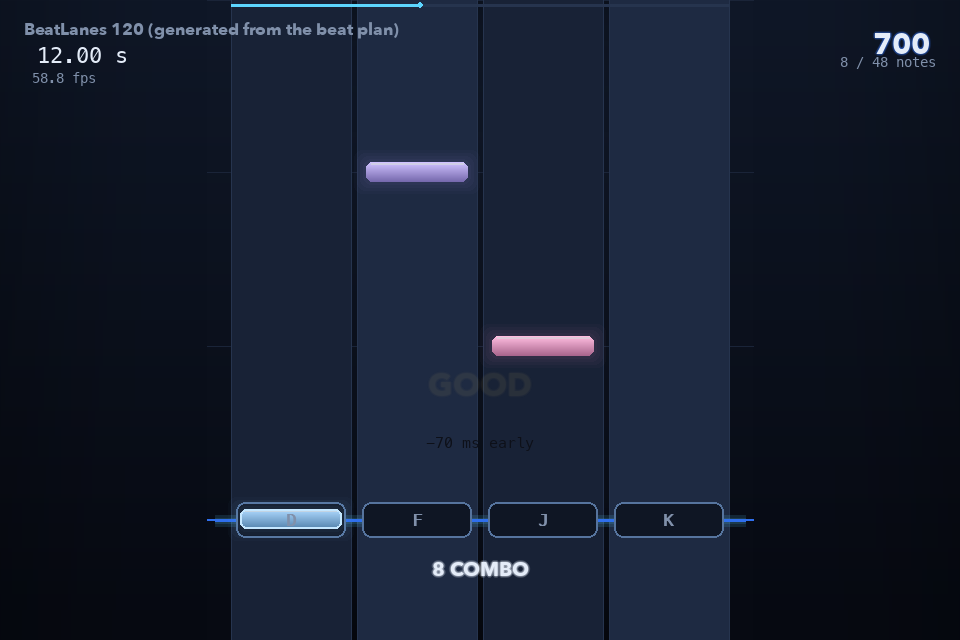
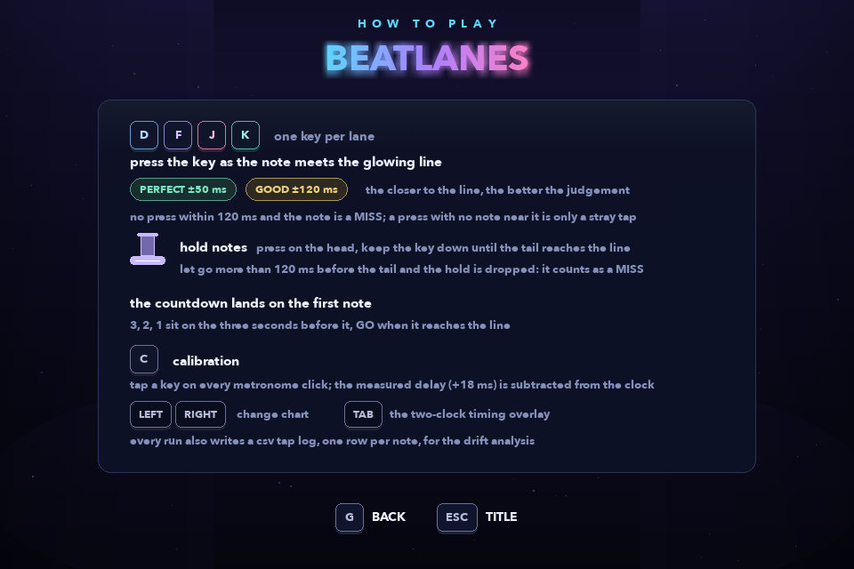
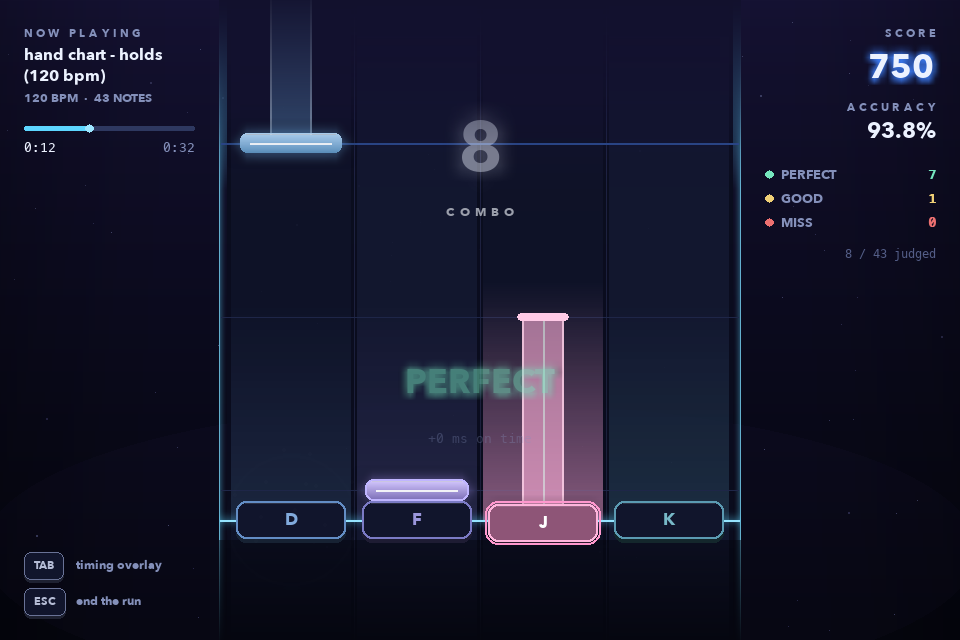

# BeatLanes

A four lane keyboard rhythm game for PC, written in Python with Pygame.

Notes fall down four lanes and you hit **D F J K** as they reach the judgement
line. Hold notes have a tail: press on the head and keep the key down until the
tail reaches the line. The interesting part is not the falling rectangles: it is the clock. A
rhythm game is a program that has to decide whether a key press landed on a beat,
and BeatLanes does that by comparing the moment of the press against the moment
the note was supposed to arrive, in milliseconds.



---

## Run it

```bash
pip install -r requirements.txt
python main.py
```

| Screen | Keys |
| --- | --- |
| Title | `SPACE` start, `C` calibrate, `G` guide, `LEFT` `RIGHT` change chart, `ESC` quit |
| Guide | `G` or `ESC` back to the title |
| Playing | `D` `F` `J` `K` the four lanes (keep the key down on a hold note), `TAB` debug overlay, `ESC` end the run |
| Results | `R` play again, `T` title, `ESC` quit |
| Calibration | any lane key on each click, `ESC` cancel |

There are three charts on the title screen: the one generated from the beat
plan, a hand-written one, and (since week 12) a hand-written one with hold notes.

Tested on macOS with Python 3.13.9 and Pygame 2.6.1. Nothing is pinned to a
platform: Pygame handles the window, the keyboard, the mixer and the clock.

## What you are looking at while it runs

The `TAB` overlay shows both clocks at once, which is the whole design argument
of the project in one box:

```
DEBUG                 TAB
tick clock     12016.0 ms     <- the clock the judgement uses
raw ticks           12143     <- pygame.time.get_ticks()
mixer get_pos       12009     <- the mixer's own reading, checked against it
drift               +7 ms     <- the difference between the two
offset              +0 ms     <- what the metronome test measured
fps                  59.2
```

The judgement clock is built from `pygame.time.get_ticks()`, sampled when the key
press is handled, minus the tick reading taken when the music started, minus the
calibration offset. `pygame.mixer.music.get_pos()` is read as well and shown
beside it, but it never decides a verdict: the Pygame documentation only promises
that it reports how long the music has been playing, and it does not account for
the buffer at the start of the track. It is a second opinion, not the clock.

## How a tap becomes a verdict

One subtraction, in `beatlanes/judge.py`:

```
error = tap_ms - target_ms
```

Negative means early, positive means late, and the absolute value picks the
verdict:

| |error| | verdict |
| --- | --- |
| <= 50 ms | `PERFECT` |
| <= 120 ms | `GOOD` |
| more | the press is not counted against that note |

A note nobody hits is marked `MISS` once the song has walked 120 ms past it. A
press that no note is close enough to is counted as a stray tap: it does not
consume a note and does not break the combo, but a run full of them usually means
the calibration offset is wrong.

### Hold notes (week 12)

A hold is still one note with one verdict, but it is decided at two moments.
The press goes through the same subtraction as a tap. Nothing is scored yet: the
note sits in a `HOLDING` state with the press verdict kept on it. Then one of
two things happens first:

| what happens | result |
| --- | --- |
| the tail reaches the line with the key still down | the press verdict counts (`PERFECT` or `GOOD`) |
| the key comes up at `tail - 120 ms` or later | same, nobody lets go on the exact millisecond |
| the key comes up earlier than that | the hold is dropped and counts as a `MISS` |

The release rule is `hold_was_kept()` in `beatlanes/judge.py`, one comparison.
A key-up only matters while a hold is down in that lane, so taps behave exactly
as they did before. Losing window focus mid-hold counts as letting go, because
the real key-up goes to the other window.

## The files

```
main.py                  entry point, command line options, the selftest plan
beatlanes/
  config.py              every shared setting: lane geometry, windows, colours
  judge.py               error = tap - target, the PERFECT/GOOD/MISS rules, the hold release rule
  chart.py               loading and checking chart JSON, taps and holds
  songclock.py           the tick clock, the mixer reading, and the offset
  scoring.py             combo, score, accuracy and rank
  session.py             one play-through: note states, taps, hold key-ups, misses
  logbook.py             the CSV tap log, writing and reading back
  calibration.py         the tap-to-metronome offset, and saving it
  audio.py               mixer setup, the metronome click, the song
  render.py              drawing only - no timing rules live here
  hidpi.py               the Windows display scale, so text is drawn sharp
  app.py                 states, events and the frame loop
tools/
  beatplan.py            the beat grid the song and the chart are both built from
  make_song.py           generates assets/beatlanes_120.ogg
  make_chart.py          generates charts/beatlanes_120.json
  analyse_log.py         reads a tap log and reports on the timing
charts/
  beatlanes_120.json     48 notes over 16 bars, generated
  hand_120.json          60 notes, written by hand
  holds_120.json         43 notes, 11 of them holds, written by hand (week 12)
assets/
  beatlanes_120.ogg      33 seconds, generated by tools/make_song.py
tests/                   155 unit tests
logs/                    tap logs from your own runs land here
docs/shots/              screenshots used in the written reflection
```

## Where the song comes from

There is no downloaded audio anywhere in this repository. `tools/make_song.py`
synthesises the backing track from scratch with numpy: a kick whose pitch drops
and whose amplitude decays, hats made of short noise bursts, a bass line, and a
triangle wave arpeggio.

```bash
python tools/make_song.py     # writes assets/beatlanes_120.ogg
python tools/make_chart.py    # writes charts/beatlanes_120.json
```

Both read `tools/beatplan.py`, so the notes and the drums are placed on the same
beat grid: the chart cannot drift out of time with the song, because the times of
both come from the same four numbers. Generating the audio also means there is no
third party licence to track and no download link that can go dead.

## Tests, and the automatic run

```bash
python -m unittest discover -s tests -t .    # 155 tests
python main.py --selftest                    # play a whole chart and check it
python main.py --selftest --chart charts/holds_120.json   # the same, with hold notes
python main.py --autoplay                    # watch a run without touching the keys
python main.py --screenshot out.png --at 12000 --shot-taps
python tools/analyse_log.py logs/taps-*.csv --plot docs/shots/histogram.png
```

`--selftest` plays the chart headlessly with a prepared list of taps whose timing
errors cover all three windows, then prints what it expected against what
happened. It is the same code path as a normal run: same session, same
judgement, same log. On a chart with holds it also feeds key-ups - some on the
tail, some just inside the allowance, one far too early - and checks how many
holds were kept and dropped. The presses, the key-ups and the expected counts
all come from `selftest_plan()` in `main.py`, so they cannot drift apart.

`--autoplay` does the same thing in a real window with real sound, which is how a
log gets real mixer readings in it. `--windowed --screenshot` uses the same trick
to capture a frame at a chosen moment, and the screenshots in `docs/shots/` were
made that way.

## Reading a tap log

Every run writes a CSV with one row per note:

```
note_index,lane,target_ms,tap_ms,error_ms,verdict,mixer_pos_ms,hold_ms,release_ms
0,0,8000,8000,+0,PERFECT,,0,
3,3,9500,9530,+30,PERFECT,,0,
4,1,10000,9960,-40,PERFECT,,1500,11500
11,2,14500,,,MISS,,0,
13,3,16000,16000,+0,MISS,,1000,16600
```

(These rows are from `python main.py --selftest --chart charts/holds_120.json`,
which runs without sound, so the mixer column is empty. A run with the music
playing fills it, as in `docs/samples/taps-example-with-audio.csv`.)

Missed notes still get a row, with the tap and error columns left empty, so the
log shows the shape of a run and not only its successes. The last two columns
came in with week 12: `hold_ms` is 0 for a tap and the tail length for a hold,
and `release_ms` is when a hold's key came up, left empty if it was still down
when the tail arrived. A row is written when its note is finished, so a hold's
row comes after the taps played across it. Row 13 above is a dropped hold: the
press was on time (`+0`), the key came up 400 ms before the tail, so the verdict
is `MISS`. Logs written before week 12 have no hold columns and still read fine.

`tools/analyse_log.py` turns a log into the numbers the calibration step needs:

```
all taps   mean    -0.6 ms   median    +0.0 ms   spread  35.4 ms   range -70 to +60 ms
early      mean   -38.3 ms   median   -40.0 ms   ...                 (3 taps)
late       mean   +27.5 ms   median   +22.5 ms   ...                 (4 taps)
tick clock vs mixer        mean    -2.4 ms   median    -4.0 ms   spread   4.7 ms
```

On a log with holds it adds one line:

```
holds      11   kept 9   dropped 1   never pressed 1
```

The distinction that matters: a run where every tap is late by roughly the same
amount is a calibration problem, and it is fixed by subtracting an offset. A run
where taps are scattered either side of zero is a player problem, and no offset
will fix it. That is why the tool prints the mean and the median next to each
other.

## Credits

- **Pygame** (2.6.1) - window, input, audio, timing. https://www.pygame.org
- **numpy** - used only by the song generator, for the sample maths.
- **soundfile** - used only by the song generator, to write the OGG.
- **Matthes, E. (2023).** *Python crash course* (3rd ed.), chapters 12-14 - the
  window, the game loop and the event handling follow the structure taught there.
- **Craven, P. (2016).** *Program arcade games* - sound and keyboard handling.
- **Watkiss, S. (2020).** *Beginning game programming with Pygame Zero* - the
  gentler introduction the event loop was checked against.

The lane patterns, the judgement windows, the calibration design and all of the
code in this repository were written for this project. Libraries are listed above
and are also named where they are used in the code.

## If the keys stop responding (Windows, input methods)

Found in week 11 on a Windows machine with a Chinese input method: the first
notes scored, then nothing did, and on the results screen `R` and `T` were dead
while `ESC` still quit.

pygame 2 starts with text input switched on, and SDL switches it back on every
time the window gets focus. That attaches the input method (IME) to the game
window. In Chinese mode the IME takes every letter key, and SDL drops those
presses instead of turning them into `KEYDOWN` events. Keys the IME does not
want - `ESC`, `SPACE`, `TAB`, the arrows - still get through, which is exactly
the pattern above.

The game now calls `pygame.key.stop_text_input()` when the window opens and
again whenever it regains focus, which detaches the IME from the window
(`BeatLanesApp._disable_text_input` in `beatlanes/app.py`, covered by
`tests/test_app.py`). If a machine still shows the problem, switching the
input method to English (`Shift` on the Microsoft Pinyin IME, or `Win + Space`
to another keyboard) before starting is the manual workaround.

Every lane press now lights its key whether it scores or not, so "the key was
not read" and "the key was read but missed the note" look different on screen.

## If the text looks blurry (Windows display scaling)

Also found in week 11, on a laptop with Windows set to 150%. The game drew a
960x640 frame and did not tell Windows it understood the scale, so Windows
stretched the finished frame to 1440x960 with a smoothing filter. Every letter
came out soft, and the gaps between letters became uneven because each pixel
turned into one or two.

The game now marks itself DPI aware on Windows, reads the display scale, and
draws the whole frame at that size (`beatlanes/hidpi.py`, `render.set_ui_scale`).
The layout is still designed at 960x640; every length and font size is
multiplied by the scale before it is drawn, so at 150% the fonts are real
1.5x glyphs instead of a stretched bitmap. If the window would not fit on the
screen (150% on a 1920x1080 laptop) it steps down a little. At 100% nothing
changes. `--scale 1.5` forces a scale, which is also how the sharp screenshots
in `docs/shots` were taken on a Mac.

## Week 11 changes

- the input method fix above, plus a fallback that finds D F J K (and R, T, C)
  by their physical position when the keyboard layout names them differently
- a MISS popup and a red key flash when a note is missed; before this a miss
  was silent
- the title screen chart picker, last run line and status line no longer draw
  on top of each other
- visual pass: one highway instead of four loose strips, notes that come out of
  the dark, key caps that light while held, a side HUD that keeps the lanes
  clear, a ring countdown, a results card with a timing strip, a window icon
- best accuracy per chart for the session, with a NEW BEST badge, and a
  FULL COMBO badge
- sharp text on scaled Windows screens, see above; `--scale` on the command line
- the PERFECT / GOOD / MISS popup no longer flashes as a solid box: after a word
  faded out once, the next full-strength draw of it lost its transparency
  (`set_alpha(None)` also switches off per-pixel alpha in pygame 2)
- the frame is drawn on a 32-bit surface instead of 24-bit, which makes the
  translucent layers about five times cheaper - a play frame at 1440x960 takes
  about 1.5 ms on the test Mac

## Week 12 changes

The plan for week 12 was "fix what broke, a short guide, hold notes only if the
song already works". All three are in.

- **The short guide.** `G` on the title screen opens one screen with everything
  a first run needs: the four lanes and the one rule, the two windows and what a
  `MISS` and a stray tap are, how a hold works, the countdown, what calibration
  is for, chart switching, the two-clock overlay and the tap log. Six rows, no
  scrolling, `G` or `ESC` to go back. The first version left a gap under the
  windows row; the rows are now evenly packed.
- **Hold notes.** See "Hold notes" above. New chart `charts/holds_120.json`,
  a `hold` field in the chart format (missing means a tap, so the old charts
  load unchanged), a `HOLDING` note state, key-ups handled in play, a body and
  tail drawn from the same song clock as the head, a lit key while it is held, a
  `HOLDS` column on the results screen and the hold count on the title card.
  A chart that puts a note in a lane while that lane's hold is still down is
  rejected when it loads.
- **Fixed: the hand chart ran past the end of the song.** Its finale went on to
  34.5 s, but the song is 33 s, so the last six notes came after the music had
  stopped, and its `note_count` said 64 for 60 notes. The same sixteen notes now
  sit inside bars 14-15 as the eighth-note run the section note always described.
  A test now checks every chart on the title screen ends inside the song.
- The title screen build tag said "week 11 build"; it is now v0.10.0, week 12.
- `tools/analyse_log.py` reports kept, dropped and never-pressed holds.
- 111 tests became 155. The generated chart's selftest numbers did not change:
  30 / 12 / 6 / 6, 75.0%.




`docs/shots/21-results-holds.png` is the results screen of the holds selftest
(the `HOLDS 9/11` column) and `docs/shots/22-title-w12.png` the week 12 title
screen with the `G` guide key.

## Known limits

- A hold is all or nothing: let go halfway and it is a `MISS`, with no partial
  credit for the part that was held. A dropped hold's remaining body disappears
  with the `MISS` instead of scrolling past greyed out.
- Four lanes, one keyboard layout. Lane keys are not rebindable.
- The mixer reading is a check, not a clock, for the reasons above. On a machine
  where the audio buffer is unusually large, the tick clock plus the calibration
  offset is what holds the timing together.
